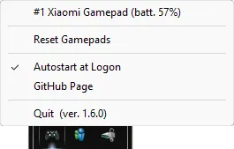

# (My) Mi Vigem

XBox360 controller emulation for Xiaomi gamepad. Supports multiple devices and vibration.

## Notable Features of this Fork

- Resolves disabled HID device getting stuck on windows 11
- Resolves turned off gamepads occupying virtual gamepad on windows 11
- Reset Gamepads clears everything
- Resolves infinite rumble with proper command retries, instead of a 2 second safety.
- Only allows a single instance running.

## Requirements

- ViGEm bus driver needs to be installed https://github.com/ViGEm/ViGEmBus/releases

## User interface

## Xiaomi Gamepad

